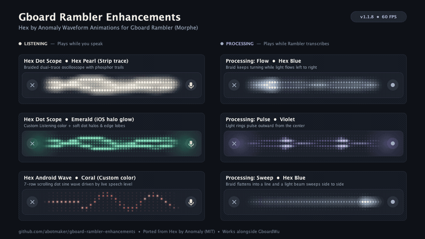
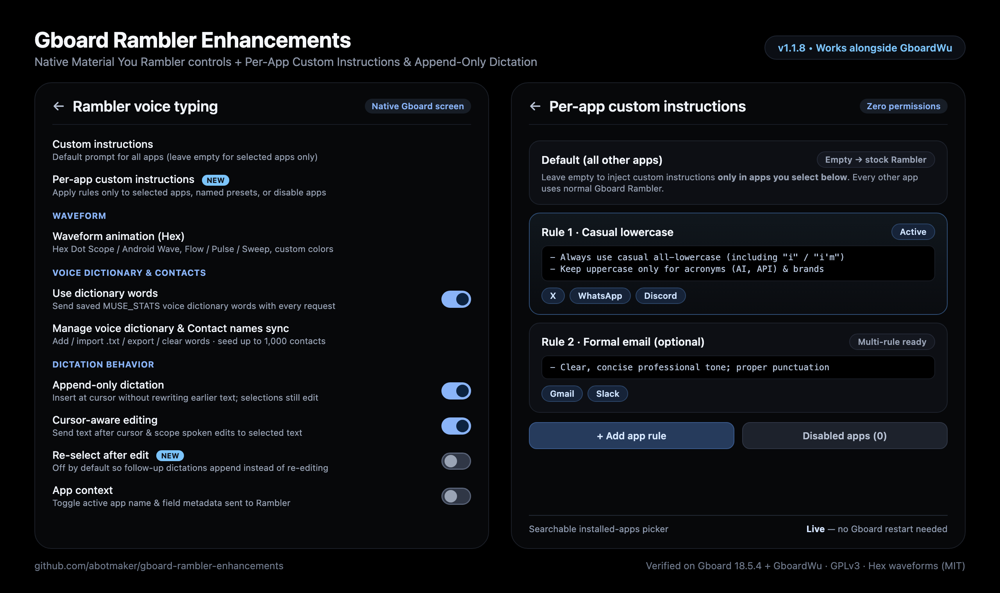

# Gboard Rambler Enhancements

Standalone [Morphe](https://morphe.software) patches for **Gboard Rambler** (Agentic Voice Typing): **[Hex by Anomaly](https://github.com/anomalyco/hex)** waveforms + high-productivity voice tools. Built to stack cleanly **alongside upstream [GboardWu](https://github.com/jasonwu1994/Gboard-patches)** (`v4.5.0+`).

  

  
Preview: Native <strong>Rambler voice typing</strong> settings &amp; <strong>Per-app rules</strong>

  

    
  

---

## Quick Setup (With GboardWu)

1. **Add both sources in Morphe Manager:**
   - **GboardWu:** `https://raw.githubusercontent.com/jasonwu1994/Gboard-patches/main/patches-bundle.json`
   - **Rambler Enhancements:** `https://raw.githubusercontent.com/abotmaker/gboard-rambler-enhancements/main/patches-bundle.json`
2. **Select patches:**
   - In **GboardWu**: enable **`Advanced Voice Typing`** *(required)* + any other GboardWu patches you want (`Package Rename`, `Clipboard Enhancements`, `Custom Theme`, `Cursor Trackpad`, etc.).
   - In **Rambler Enhancements**: pick any of the **7 patches** below *(all default ON)*.
3. **Avoid duplicates:** Don't stack Rambler patches from another fork (`nl-morphe-patches` or combined forks) in the same APK.

> **Compatibility:** Verified on Gboard **`18.5.4.993608717-release-arm64-v8a`** (standalone & stacked with GboardWu `v4.5.0+`). Newer `18.5.4+` builds use dynamic fingerprinting (best-effort, unverified). **Android 13+ (API 33+)** required for Hex AGSL waveforms.

---

## Included Patches (7)

Settings live inside **Gboard Settings → Voice typing → Rambler voice typing** and the 1-tap **Rambler** toolbar icon:

1. **`Rambler Waveform Animation`** *(Hex by Anomaly)* — Replaces Rambler's light bar with **Hex Dot Scope** / **Hex Android Wave** listening animations + **Flow / Pulse / Sweep** processing animations, independent colors, and glow/dot tuning.
2. **`Rambler Productivity Tools`** —
   - **Long-press Spacebar for Rambler** *(Smart Hybrid / Hold-to-Talk / Toggle modes; keeps Spacebar-swipe 2D Cursor Trackpad working)*
   - **Smart Search Bars** *(auto-strip trailing period ON by default + opt-in per-app **Auto-Search on commit** for Chrome, YouTube, Play Store, Settings, etc.)*
   - **Draggable Rambler Toolbar Button** *(1-tap jump to settings)*
   - **Voice Actions, Snippets & Find/Replace** *(hands-free `"hit send"` / `"hit search"` suffixes, literal snippets, plain/regex global or per-app replacements, Strip Trailing Period)*
   - **Private On-Device Dictation Stats & History** *(words, WPM, cloud latency, time saved vs typing, 50-entry history card with **1-Tap Fix & Learn** word chips)*
   - **Reliability & Backup** *(Auto Parallel Retry, Longer Dictation Sessions, one-tap `.json` Backup & Restore)*
3. **`Rambler Custom Instructions`** *(credit: [nl-morphe-patches](https://gitlab.com/johninnld/nl-morphe-patches))* — Default + **Per-app custom instructions** with named rules, searchable app picker, disabled apps, and per-app behavior overrides.
4. **`Rambler Personal Dictionary`** *(credit: nl-morphe-patches)* — Live `MUSE_STATS` voice biasing dictionary with add, `.txt` import/export, remove, and clear.
5. **`Rambler Contact Names`** *(requires Personal Dictionary)* — Seeds up to 1,000 phone contacts into `MUSE_STATS` (with Contacts permission).
6. **`Rambler Cursor-Aware Editing`** *(credit: nl-morphe-patches)* — Cursor-aware & selection-only edits, **Re-select after edit** *(off by default)*, and **Append-only dictation** with clean boundary spacing.
7. **`Rambler App Context`** *(credit: nl-morphe-patches)* — Shares active app name, input type, and field hint so Rambler adapts formatting.

---

  
<strong>Hex Waveform Animations — Stage Reference</strong>

| Setting | Options | When Shown |
|---|---|---|
| **Listening** | **Hex Dot Scope**, **Hex Android Wave**, **Gboard Default** | While speaking |
| **Processing** | **Flow**, **Pulse**, **Sweep** | Briefly after stopping while transcribing |
| **Colors & Tuning** | Independent Listening/Processing colors, `Strip trace` vs `iOS halo`, dot spacing, glow, voice response | Both stages |

  
<strong>Technical: Why This Stacks Cleanly With GboardWu</strong>

- **Flags:** Hooks Gboard's internal flag resolution (`oki.x()`) instead of `oki.g()`, leaving GboardWu's flag composer untouched.
- **Touch release:** Wraps `SoftKeyboardView.dispatchTouchEvent` via verbatim rename + branchless wrapper — zero shifted instructions inside GboardWu `v4.5.0+`'s Clipboard Select All wrapper in either patch order.
- **Contacts & Settings:** Hooks `AgenticDictationExtension.<init>` (not `hU()`), and launches a non-exported settings activity via explicit package intent — immune to `Package Rename`.

---

## Credits & License

- **Waveforms:** [Hex by Anomaly](https://github.com/anomalyco/hex) (MIT — see [`THIRD-PARTY-NOTICES.md`](THIRD-PARTY-NOTICES.md))
- **Rambler patches:** Adapted from [`nl-morphe-patches`](https://gitlab.com/johninnld/nl-morphe-patches) · Built for [Morphe](https://morphe.software) · Designed for [GboardWu](https://github.com/jasonwu1994/Gboard-patches)
- **License:** [GNU GPL v3.0](LICENSE)
